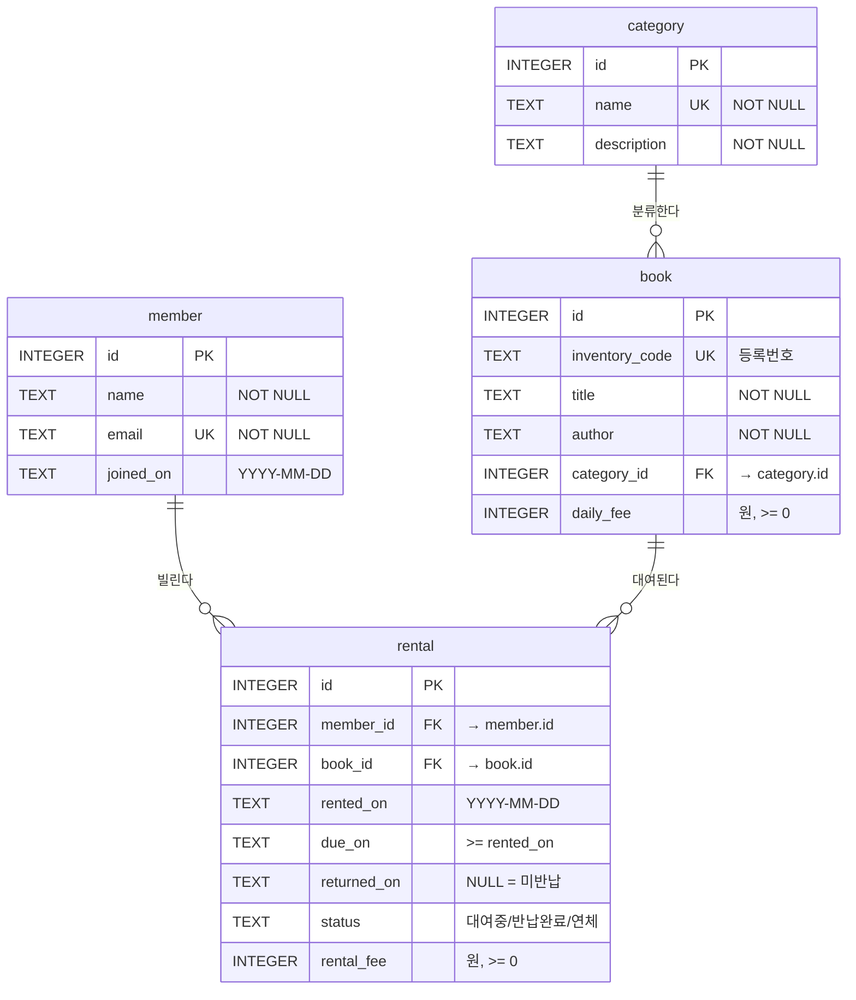

# B5-1 도서 대여 데이터베이스

SQLite로 회원, 소장 도서, 카테고리, 대여 기록을 관리하는 SQL 데이터베이스다. SQL만 사용하며 실행 도구는 `sqlite3` CLI다.

## 프로젝트 파일

| 파일 | 역할 |
| --- | --- |
| [schema.sql](schema.sql) | `member`, `category`, `book`, `rental` 테이블과 제약조건 정의 |
| [insert.sql](insert.sql) | 실행 재현용 샘플 데이터 입력 |
| [queries.sql](queries.sql) | Q01~Q15 조회·수정·삭제·인덱스 SQL |
| [results/results.txt](results/results.txt) | 쿼리 실행 결과 |
| [demo.sql](demo.sql) | 주요 동작 확인 스크립트(제약조건 차단, JOIN 비교, 집계 검산, 실행 계획). 메모리 DB에서 실행하며 변경은 모두 ROLLBACK |

## 실행 및 결과 재현

검증 환경: macOS / SQLite 3.51.0. 별도 서버, 백엔드 프레임워크, 추가 패키지가 필요 없다. 터미널에서 다음 순서로 실행한다.

```sh
cd b5-1-library-db
sqlite3 --version
run_dir=$(mktemp -d /tmp/b5-1-replay.XXXXXX)
sqlite3 "$run_dir/library.db" < schema.sql
sqlite3 "$run_dir/library.db" < insert.sql
sqlite3 "$run_dir/library.db" < queries.sql > "$run_dir/results.txt"
cat "$run_dir/results.txt"
diff -u results/results.txt "$run_dir/results.txt"
```

`diff` 출력이 없으면 제출 결과와 같다. 실행 계획의 표현은 SQLite 버전에 따라 달라질 수 있다. 생성한 DB와 결과는 `$run_dir`에 남아 직접 열어볼 수 있다. 각 명령이 성공한 뒤 다음 명령을 실행한다. 재실행할 때는 위 명령으로 새 디렉터리와 새 DB를 만든다. 동일한 DB에 다시 실행하면 테이블·인덱스 중복 오류가 나거나 수정 전 상태가 달라진다.

모든 스크립트는 `.bail on`으로 오류가 나면 해당 스크립트를 중단한다. `.print`, `.headers`, `.mode` 등 점 명령은 SQLite CLI 전용이므로 일반 DB GUI의 SQL 편집기에 그대로 붙여 넣지 않는다. `PRAGMA foreign_keys = ON`은 연결마다 필요하므로 세 파일에 모두 적었다. 외래 키는 참조 대상이 없는 입력을 거부하며, 부모 행의 삭제·키 변경도 연결된 자식이 있으면 기본 동작인 `NO ACTION`으로 거부한다. SQLite 전용 날짜 함수, PRAGMA, 실행 계획 구문은 SQL에 주석을 달았다.

실행 결과는 [results/results.txt](results/results.txt)에 Q01~Q15 순서로 저장했다. Q13~Q15의 추가 SELECT·PRAGMA·실행 계획은 변경 결과를 증명하는 보조 확인 구문이다. Q01~Q12는 초기 16건의 대여를 대상으로 한다. Q13은 3건을 연체로 갱신하고 Q14는 정정 대상 1건을 삭제하므로, 끝난 DB에서 이전 조회를 다시 실행하면 일부 결과가 달라진다.

## 테이블 개요

| 테이블 | 역할과 주요 컬럼 | 최초 행 수 |
| --- | --- | ---: |
| member | 회원 ID, 이름, 이메일, 가입일 | 12 |
| category | 카테고리 ID, 이름, 설명 | 10 |
| book | 소장 도서 ID, 등록번호, 제목, 저자, 카테고리 ID, 일일 대여료 | 12 |
| rental | 대여 ID, 회원 ID, 도서 ID, 대여일, 반납 기한, 실제 반납일, 상태, 약정 대여료 | 16 |

### ERD



`||--o{` 는 1:N(한쪽 1개, 다른 쪽 0개 이상)을 뜻한다. 예: 회원 1명은 대여 기록을 0건 이상 가지며, 대여 기록 1건은 반드시 회원 1명에 속한다.

`schema.sql`에는 `category → book`, `member → rental`, `book → rental` 1:N 외래 키 관계가 정의되어 있다. `book`은 대여 가능한 소장본을, `rental`은 회원이 소장본을 빌린 기록을 나타낸다.

## 설계 설명

### 데이터를 테이블로 나눈 이유

도서 대여 업무에는 회원, 책, 책의 분류, 대여라는 네 가지 대상이 등장한다. 이것을 하나의 표에 모두 적으면 대여가 일어날 때마다 회원 이름, 이메일, 책 제목, 카테고리 이름을 반복해서 적어야 한다. 그러면 회원이 이름을 바꿨을 때 그 회원의 대여 행을 전부 찾아 고쳐야 하고, 한 곳이라도 빠뜨리면 같은 회원이 두 이름으로 남는다.

그래서 대상마다 테이블을 하나씩 두고, 각 정보는 한 곳에만 저장했다. `member`는 회원 한 명, `category`는 분류 하나, `book`은 실제로 빌려줄 수 있는 소장본 한 권, `rental`은 회원이 소장본을 빌린 사건 한 번을 한 행으로 나타낸다. 대여 기록에는 회원과 책의 정보를 복사하지 않고 `member_id`, `book_id` 번호만 남긴다. 이름이 바뀌면 `member` 한 행만 고치면 되고, 조회할 때 JOIN으로 연결하면 모든 대여 기록에 바뀐 이름이 나타난다.

이 점이 엑셀 같은 스프레드시트와 관계형 DB의 차이이기도 하다. 스프레드시트는 셀에 무엇이든 적을 수 있어 편하지만, 시트 사이의 연결이나 값의 규칙을 사람이 지켜야 한다. DB는 PK·FK·제약조건으로 규칙을 선언해 두면, 존재하지 않는 회원 번호나 형식이 틀린 날짜를 DB가 직접 거부한다.

`book`을 "책 종류"가 아니라 "소장본 한 권"으로 정의한 것도 같은 이유다. 같은 제목의 책을 두 권 가지고 있으면 각각 다른 `id`와 등록번호(`inventory_code`)를 갖고, 대여는 특정 소장본을 가리킨다.

### 테이블 사이의 관계

PK(기본 키)는 자기 테이블에서 한 행을 구별하는 번호다. `member.id = 1`은 김하늘 한 명을, `rental.id = 1`은 대여 한 건을 가리킨다. FK(외래 키)는 다른 테이블의 PK를 가리키는 컬럼이다. `rental.member_id = 1`은 그 대여가 김하늘의 기록이라는 뜻이다. 같은 회원 번호가 여러 대여 행에 반복해서 나올 수 있으므로 회원과 대여는 1:N 관계가 된다.

| 관계 (1 → N) | 연결 컬럼 | 샘플 데이터에서의 의미 |
| --- | --- | --- |
| category → book | `book.category_id` → `category.id` | 소설(1)에 별빛 도서관(1), 바다를 걷는 사람(2)이 속한다. 시(10)에는 아직 책이 없다. |
| member → rental | `rental.member_id` → `member.id` | 김하늘(1)이 대여 1·3·10번을 남겼다. 한소율(11)·오준서(12)는 대여 이력이 없다. |
| book → rental | `rental.book_id` → `book.id` | 별빛 도서관(1)은 8월(대여 1번)과 9월(대여 10번)에 두 번 빌려졌다. |

회원과 책은 원래 "한 회원이 여러 책을, 한 책을 여러 회원이" 빌리는 다대다 관계다. 이것을 `rental`이 가운데에서 두 FK로 잇는 1:N 관계 두 개로 풀었다.

FK 검사는 SQLite에서 기본으로 꺼져 있고 연결할 때마다 다시 켜야 한다. 그래서 모든 스크립트 첫머리에 `PRAGMA foreign_keys = ON;`을 두었다. 켜진 상태에서는 없는 회원 번호(예: 999)로 대여를 넣으면 `FOREIGN KEY constraint failed`로 거부된다. 반대로 대여 기록이 남아 있는 회원을 지우는 것도 막혀서, 주인 없는 대여 기록이 생기지 않는다.

### 컬럼 타입과 제약조건

타입은 "이 값으로 무엇을 할 것인가"를 기준으로 골랐다. 모든 `id`는 행을 구별하고 비교하는 번호라서 `INTEGER PRIMARY KEY`다. 이름, 이메일, 제목, 상태처럼 계산하지 않는 값은 `TEXT`다.

금액(`daily_fee`, `rental_fee`)은 원 단위라 소수점이 없고, 소수 타입(`REAL`)은 `0.1 + 0.2`가 정확히 `0.3`이 되지 않는 오차가 있어 `INTEGER`로 저장했다. 음수가 될 수 없도록 `CHECK (>= 0)`을 걸었다.

SQLite에는 DATE 전용 타입이 없어서 날짜는 `YYYY-MM-DD` 형식의 `TEXT`로 저장했다. 월과 일을 두 자리로 맞추면 문자열의 크기 비교 순서가 날짜 순서와 같아진다(`'2026-09-27' < '2026-10-04'`는 참이지만, `'2026-9-27'`로 적으면 거짓이 된다). 그래서 `BETWEEN`, `<`, `ORDER BY`를 그대로 쓸 수 있다. `date(값, '+0 days') = 값` 검사를 함께 걸어 `2026-02-30`처럼 존재하지 않는 날짜는 거부한다.

실제 반납일(`returned_on`)은 아직 반납하지 않은 상태를 나타내야 해서 NULL을 허용했다. 대신 상태가 `반납완료`이면 반납일이 반드시 있고, `대여중`·`연체`이면 비어 있도록 CHECK로 묶었다. 반납 기한과 반납일은 대여일보다 앞설 수 없고, 상태는 세 가지 값만 받는다.

이메일, 카테고리 이름, 등록번호는 중복되면 안 되므로 `UNIQUE`다. 반면 회원 이름과 책 제목은 동명이인이나 같은 책 여러 권이 있을 수 있어 일부러 UNIQUE를 걸지 않았다.

### 인덱스

`rental.rented_on`에 `idx_rental_rented_on` 인덱스를 만들었다(Q15). 대여 기록은 계속 늘어나는 테이블이고, "최근 30일 대여"(Q03)처럼 대여일 범위로 찾는 조회가 가장 자주 쓰인다. 인덱스가 없으면 SQLite는 모든 행을 처음부터 훑고(`SCAN rental`), 정렬도 따로 한다(`USE TEMP B-TREE FOR ORDER BY`). 인덱스를 만든 뒤에는 실행 계획이 `SEARCH rental USING COVERING INDEX idx_rental_rented_on`으로 바뀐다. 날짜순으로 정리된 목차에서 범위의 시작점을 바로 찾아 끝까지 읽고, 정렬 단계도 생략한다는 뜻이다.

샘플이 16행뿐이라 속도 차이를 측정하지는 않았다. 실행 계획이 인덱스를 쓰도록 바뀐 것까지가 확인한 내용이다. 인덱스는 저장 공간을 쓰고 INSERT·UPDATE·DELETE 때마다 함께 갱신되므로, 자주 검색하는 컬럼에만 만들었다. `id`는 `INTEGER PRIMARY KEY`라서 테이블 자체가 id 순으로 저장되고, `email`·`inventory_code`·`category.name`은 UNIQUE라서 SQLite가 자동으로 인덱스를 만든다.

## 쿼리 목록과 결과

| 번호 | 분류 | 쿼리 구성 | 실제 결과의 확인 지점 |
| --- | --- | --- | --- |
| Q01 | 기본 조회 | WHERE / ORDER BY | 500원 이하 도서 8권, 요금과 ID 오름차순 |
| Q02 | 기본 조회 | ORDER BY / LIMIT | 신규 회원 12·11·10번 3명 |
| Q03 | 기본 조회 | 날짜 범위 WHERE | 대여 5~15번, 총 11건 |
| Q04 | 기본 조회 | 상태 WHERE / ORDER BY | 반납완료 10건, 반납일 최신순 |
| Q05 | 조인 | INNER JOIN | 미반납 6건에 회원 이름과 책 제목 표시 |
| Q06 | 조인 | INNER JOIN | 도서 12권의 카테고리 표시 |
| Q07 | 조인 | INNER JOIN | 대여 이력이 있는 회원과 대여 상세 16행 |
| Q08 | 조인 | LEFT JOIN | 카테고리 10번도 유지되며 book_id와 title은 NULL |
| Q09 | 집계 | GROUP BY / COUNT | 김하늘 3회, 한소율·오준서 0회 |
| Q10 | 집계 | GROUP BY / SUM | 대여중 18,200원, 반납완료 37,100원 |
| Q11 | 집계 | GROUP BY / AVG | 소설 350원, 과학 550원, 컴퓨터 750원 |
| Q12 | 서브쿼리 | NOT EXISTS | 대여 이력 없는 회원 11·12번 |
| Q13 | 수정 | UPDATE | 대여 10·11·12번 연체, 변경 3행 |
| Q14 | 삭제 | DELETE | 대여 16번 삭제 1행, 대상 잔여 0행, 전체 15행 |
| Q15 | 인덱스 | CREATE INDEX | 인덱스 목록 및 SCAN → SEARCH 실행 계획 |

Q03과 Q13은 기준일을 **2026-10-04**로 고정해 실행한다. 따라서 결과가 시스템의 현재 날짜에 따라 달라지지 않는다.

## 쿼리 해설

### INNER JOIN과 LEFT JOIN의 결과 차이

두 JOIN 모두 FK와 PK가 같은 행끼리 이어 붙인다. 차이는 짝이 없는 행을 어떻게 처리하느냐에 있다. INNER JOIN은 양쪽에 모두 짝이 있는 행만 남기고, LEFT JOIN은 왼쪽(`FROM` 뒤) 테이블의 행을 모두 남긴 채 짝이 없는 오른쪽 칸을 NULL로 채운다.

Q07은 회원과 대여를 INNER JOIN하므로 대여 이력이 있는 회원 1~10번만 나오고, 한 번도 빌리지 않은 11·12번은 결과에서 빠진다. Q08은 카테고리를 기준으로 도서를 LEFT JOIN하므로 책이 한 권도 없는 시 카테고리도 `10 | 시 | NULL | NULL`로 남는다. 같은 쿼리를 INNER JOIN으로 바꾸면 결과가 13행에서 12행으로 줄고 시 카테고리가 사라진다.

그래서 "있는 것만" 볼 때는 INNER JOIN을, "전부 보여주되 없으면 없다고" 표시해야 할 때는 LEFT JOIN을 썼다. LEFT JOIN 뒤에 `WHERE 오른쪽.id IS NULL`을 붙이면 짝이 없는 행만 골라낼 수도 있다.

### GROUP BY와 집계 함수

`GROUP BY`는 지정한 컬럼 값이 같은 행끼리 묶고, 집계 함수는 묶음마다 값 하나를 계산한다. Q10은 대여 기록 16행을 상태별로 묶어 두 줄로 만든다. 대여중 6건의 약정 금액 합계는 18,200원, 반납완료 10건은 37,100원이다(실제 수납액이 아니라 대여 시 확정한 금액의 합이다).

Q11은 도서를 카테고리별로 묶어 일일 대여료의 평균을 구한다. 소설은 300원과 400원이라 평균 350원, 컴퓨터는 700원과 800원이라 750원으로 직접 계산한 값과 같다. `FROM book`에서 시작하므로 책이 없는 시 카테고리는 묶을 행이 없어 결과에 나오지 않는다.

`COUNT(*)`는 행의 개수를, `COUNT(컬럼)`은 그 컬럼이 NULL이 아닌 행의 개수를 센다. 이 차이가 Q09에서 중요하게 쓰인다. 묶은 뒤 SELECT에는 묶은 기준 컬럼이나 집계 결과만 둔다. 그룹을 거른 결과가 필요할 때는 WHERE가 아니라 HAVING을 쓴다.

### Q09 회원별 대여 횟수

```sql
SELECT m.id, m.name, COUNT(r.id) AS rental_count
FROM member AS m
LEFT JOIN rental AS r ON r.member_id = m.id
GROUP BY m.id, m.name
ORDER BY rental_count DESC, m.id;
```

JOIN, GROUP BY, 집계, 정렬이 모두 들어간 쿼리다. SQL은 적는 순서와 실행 순서가 달라서, `FROM → JOIN → GROUP BY → SELECT → ORDER BY` 순서로 따라가면 이해하기 쉽다.

1. 결과의 기준이 "회원 한 명"이므로 `member` 12명에서 시작한다.
2. 대여 기록을 LEFT JOIN으로 붙인다. 회원 한 명이 대여 건수만큼 여러 행으로 늘어나 18행이 되고, 대여가 없는 11·12번은 대여 칸이 NULL인 행 하나로 남는다.
3. `GROUP BY m.id, m.name`으로 같은 회원의 행을 다시 한 줄로 접는다. 이름이 같아도 id가 다르면 다른 회원으로 묶인다.
4. `COUNT(r.id)`로 실제 대여만 센다. NULL은 세지 않으므로 11·12번은 0회가 된다.
5. 많이 빌린 순으로 정렬하고, 횟수가 같으면 id 순으로 정렬해 결과 순서를 항상 같게 만든다.

결과는 김하늘 3회, 이서준·박지우·최수빈·정도윤 2회, 한소율·오준서 0회로, 샘플 데이터의 대여 기록과 일치한다.

## 구현하며 고민한 점

**대여 0회 회원이 결과에서 사라지는 문제.** Q09를 처음에 INNER JOIN으로 작성하면 대여 이력이 없는 회원 두 명이 빠졌다. "모든 회원의 대여 횟수"라는 목적에 맞지 않아 LEFT JOIN으로 바꿨다. 그런데 이번에는 `COUNT(*)`가 두 회원을 1회로 셌다. LEFT JOIN이 NULL로 채운 행 하나를 행 개수로 센 것이다. NULL을 세지 않는 `COUNT(r.id)`로 바꿔 0회가 나오게 했다.

**FK가 기본으로 꺼져 있는 문제.** SQLite는 FK를 선언해도 `PRAGMA foreign_keys`가 꺼져 있으면 검사하지 않는다. 실제로 끈 상태에서는 없는 회원 번호 999로 대여가 그대로 들어갔다. 이 설정은 연결마다 초기화되므로 세 스크립트 모두의 첫머리에 켜는 구문을 넣고, 없는 값 참조가 거부되는지 직접 확인했다.

**날짜 비교와 기간 경계.** 날짜를 문자열로 저장하기 때문에 자릿수가 어긋나면 비교 결과가 틀어진다. 그래서 `YYYY-MM-DD` 형식을 CHECK로 강제했다. "최근 30일"은 기준일을 포함해 30일이 되도록 시작일을 `-29 days`로 정했다. 연체는 `due_on < 기준일`로 정의해 기한 당일은 아직 연체가 아니게 했다. 경계 바로 앞뒤에 해당하는 샘플을 넣어 의도대로 걸러지는지 확인했다.

**수정·삭제가 다른 결과에 주는 영향.** Q13(UPDATE)과 Q14(DELETE)는 데이터를 바꾸므로 그 뒤에 조회를 실행하면 앞선 결과와 달라진다. 조회 쿼리를 먼저 배치하고, 변경 쿼리에는 실행 전후 상태와 `changes()`로 바뀐 행 수를 함께 남겨 의도한 행만 바뀌었음을 확인할 수 있게 했다. 삭제 조건에는 id와 상태를 모두 걸어 다른 행이 지워지지 않게 했다.

## 검증 결과

새 DB에서 세 스크립트를 순서대로 실행해 결과를 저장했다. `PRAGMA integrity_check;` 결과는 `ok`, `PRAGMA foreign_key_check;` 결과는 위반 행 없이 비어 있었다. 쿼리 실행 후 행 수는 member 12, category 10, book 12, rental 15다. 이 검사는 데이터가 무결성 규칙을 만족함을 확인한다.

## 참고 (Disclaimer)

> SQLite는 타입이 유연해서 INTEGER 칸에 문자가 들어갈 수 있습니다. 엄격하게 하려면 `CHECK (typeof(daily_fee) = 'integer')`를 추가하거나 `STRICT` 테이블을 쓰면 됩니다.
